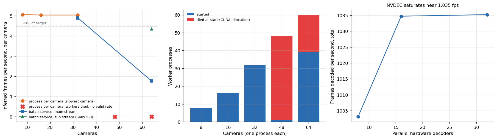

# Multi-camera RTSP capacity

**How many security cameras can one RTX 5090 watch with YOLO11?** Not the number a spec sheet gives. The detector alone could handle about 218 cameras at 5 frames per second; the real system stopped at about **32** because the cost was in decoding video and in how the processes were organized.



## Why this matters

"Images per second" from a detector benchmark is the wrong unit for a surveillance or retail-analytics product. A camera is a continuous H.264 stream that must be *decoded* before any model sees it, on a machine with a finite CPU and a hardware decoder (NVDEC), and kept alive by a process that must survive. This study built the realistic system (MediaMTX serving looped 1080p, 15 fps streams of people, bicycles and cars; FFmpeg stream-copy so the cameras cost nothing; two consumer designs) and measured where it breaks. The pass rule is strict: every camera must receive at least 90% of the 5 frames per second wanted.

## Headline results

| Design | Result |
|---|---|
| One Python process per camera (a naive design) | Passes up to **32** cameras with the slowest camera at 5.04 fps. At 48 cameras only **1 of 48** processes started; at 64, 39 of 64. The rest died with `CUBLAS_STATUS_ALLOC_FAILED` or out-of-memory while creating their CUDA context at the same moment |
| One batch service (decoder threads + one batched YOLO call per tick) on main streams | **32** cameras at 98% of target with a 78 ms median batch; **64 cameras delivers only 35%** of target |
| Same service on sub-streams (640x360, 89% fewer pixels) | 64 cameras reached 87% of target, which shows that **decoding, not inference, was the cost** |
| Hardware decoder (NVDEC) alone | saturates at 1,035 frames/s, about 69 streams of 15 fps video |
| CPU at 32 cameras | 42% (process per camera) against 39% (batch service) |

The 64-parallel-decoder row of the NVDEC table (2,456 fps) is **not valid**: most of those processes died and the survivors decoded without competition. It is kept in `data/` and excluded from the ceiling, with the reason in the article.

## What to take from it

1. **Start CUDA processes one at a time.** Launching 48 at once failed 47 of them on a card with 32 GB; the failure depends on timing, not on memory arithmetic, and is hard to reproduce. Cap the number per GPU with a margin below the highest number that worked.
2. **Batch, and send the sub-stream to the detector.** Most detection does not need 1080p. On the sub-stream the same service almost carried 64 cameras (87% of target, just under the 90% rule), where the main-stream design reached 35%.
3. **Measure the system, not the model.** The detector's own speed (1,091 images/s for YOLO11m at batch 16 on this card) overestimated the capacity of the whole system several times over.

## Repository map

```
src/cameras/   batchsvc.py (decoder threads + batched inference + per-camera frame accounting), cameras*.sh (stream setup and sweeps)
analysis/      capacity.py: pass/fail by rule, figures, summary
data/          cameras_process_per_stream.csv, cameras_rtsp_5090.csv, cameras_nvdec.csv
tests/         conclusions that must keep following from the data
```

## Reproduce

```bash
make setup && make all                                   # figures, tables, tests
bash src/cameras/cameras.sh                              # on a GPU machine with ffmpeg, MediaMTX and ultralytics: starts N streams and measures
python src/cameras/batchsvc.py urls.txt 40 5 yolo11m.pt 0
```

## Limits

Streams are looped files on the same machine, so the network is loopback and generous; bitrate is lower than many real cameras; the clip content is the same for all streams. One run per camera count, 40 to 60 seconds each after warm-up. Tracking identities across frames were not evaluated.

## Articles that use this repository

- [How many cameras can one RTX 5090 serve](https://www.kaggle.com/code/lucasrangelss/how-many-cameras-can-one-rtx-5090-serve)
- [YOLO11 on eight GPUs and a CPU-bound surprise](https://www.kaggle.com/code/lucasrangelss/yolo11-on-eight-gpus-and-a-cpu-bound-surprise)
- Related: [vision-detection-tracking-bench](https://github.com/LucasRangelSSouza/vision-detection-tracking-bench), [vast-gpu-benchmark-harness](https://github.com/LucasRangelSSouza/vast-gpu-benchmark-harness)

Licence: MIT for this code. Ultralytics is AGPL-3.0, MediaMTX MIT, FFmpeg LGPL/GPL: see `LICENSE_NOTES.md`.
